

<picture><source media="(prefers-color-scheme: dark)" srcset="assets/hero-dark.svg"></picture>

<picture><source media="(prefers-color-scheme: dark)" srcset="assets/social-l-dark.svg"></picture><a href="https://t.me/GhostlyVPNruBot"><picture><source media="(prefers-color-scheme: dark)" srcset="assets/social-1-dark.svg"></picture></a><a href="https://github.com/Nelxi/ghostly-vpn"><picture><source media="(prefers-color-scheme: dark)" srcset="assets/social-2-dark.svg"></picture></a><picture><source media="(prefers-color-scheme: dark)" srcset="assets/social-r-dark.svg"></picture>

<picture><source media="(prefers-color-scheme: dark)" srcset="assets/about-dark.svg"></picture>

<picture><source media="(prefers-color-scheme: dark)" srcset="assets/stack-dark.svg"></picture>

<a href="https://github.com/Nelxi/ghostly-vpn"><picture><source media="(prefers-color-scheme: dark)" srcset="assets/project-ghostly-vpn-dark.svg"></picture></a>&nbsp;<a href="https://github.com/Nelxi/AntiCrash-1.21.4"><picture><source media="(prefers-color-scheme: dark)" srcset="assets/project-anticrash-1-21-4-dark.svg"></picture></a>

<a href="https://github.com/Nelxi/NeuroVika"><picture><source media="(prefers-color-scheme: dark)" srcset="assets/project-neurovika-dark.svg"></picture></a>

<picture><source media="(prefers-color-scheme: dark)" srcset="assets/stats-dark.svg"></picture>

<picture><source media="(prefers-color-scheme: dark)" srcset="assets/streak-dark.svg"></picture>

<picture><source media="(prefers-color-scheme: dark)" srcset="assets/wave-dark.svg"></picture>

<a href="https://ghostlynex.fun"><picture><source media="(prefers-color-scheme: dark)" srcset="assets/button-1-dark.svg"></picture></a>&nbsp;&nbsp;<a href="https://github.com/Nelxi/ghostly-vpn/releases/latest"><picture><source media="(prefers-color-scheme: dark)" srcset="assets/button-2-dark.svg"></picture></a>&nbsp;&nbsp;<a href="https://github.com/Nelxi?tab=repositories"><picture><source media="(prefers-color-scheme: dark)" srcset="assets/button-3-dark.svg"></picture></a>

<a href="https://metawka.github.io/expressive-profile/?from=Nelxi"><picture><source media="(prefers-color-scheme: dark)" srcset="assets/credit-dark.svg"></picture></a>

